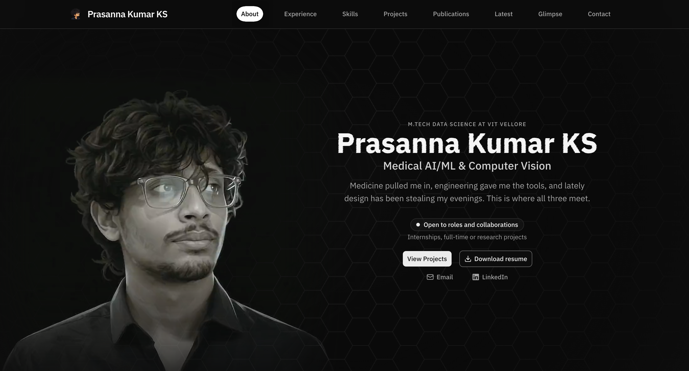

  <picture>
    <source media="(prefers-color-scheme: dark)" srcset="https://readme-typing-svg.demolab.com?font=Playfair+Display&weight=500&size=42&duration=2200&pause=100000&color=E6E6E6&center=true&vCenter=true&repeat=false&width=700&height=80&lines=Prasanna+Kumar+KS">
    
  </picture>

  M.Tech Data Science student &nbsp;·&nbsp; Medical AI/ML &amp; Computer Vision

  <a href="https://prasanna-kumar-ks.vercel.app/">Portfolio</a> &nbsp;·&nbsp;
  <a href="https://linkedin.com/in/prasanna-kumar-k-s">LinkedIn</a> &nbsp;·&nbsp;
  <a href="https://drive.google.com/file/d/1pYE4ZA_TXGhREA0zDFTuFJwgA-eUNh0Y/view?usp=sharing">Resume</a> &nbsp;·&nbsp;
  <a href="mailto:ksprasanna1719@gmail.com">Email</a> &nbsp;·&nbsp;
  <a href="https://leetcode.com/u/Prasanna__85/">LeetCode</a>

 

I’m a final-year Integrated M.Tech Data Science student at VIT Vellore, interested in building things at the intersection of AI, research, and real-world problem solving.

My primary interests lie in Medical AI, Computer Vision, and Deep Learning. I enjoy exploring how intelligent systems can be applied to meaningful problems, particularly in healthcare. From experimenting with medical imaging models to building data-driven applications, I like taking ideas beyond theory and turning them into something practical.

Beyond the technical side, I'm someone who enjoys exploring different fields, experimenting with new ideas, and learning from the people around me. Chess, UI/UX, and the occasional rabbit hole of random curiosity keep me occupied outside the code.

I believe there's always something interesting to build, something new to learn, and probably a better way to solve the next problem.
 

  
  
  
  
   
  
  

### Contribution Streak

  

---

### Contribution Activity

  

---

  <i>I like putting what I learn into practice, building things out of curiosity, and occasionally turning random ideas into something real. You can find some of them on my <a href="https://prasanna-kumar-ks.vercel.app/">portfolio</a>.</i>

  

